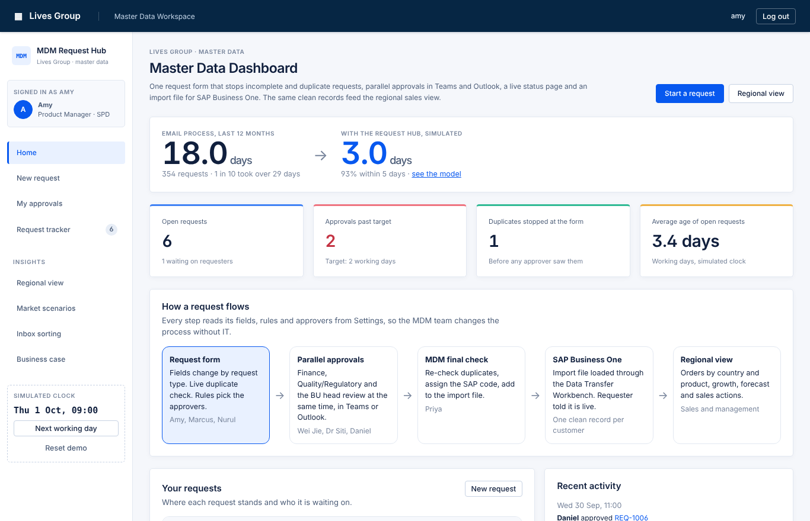
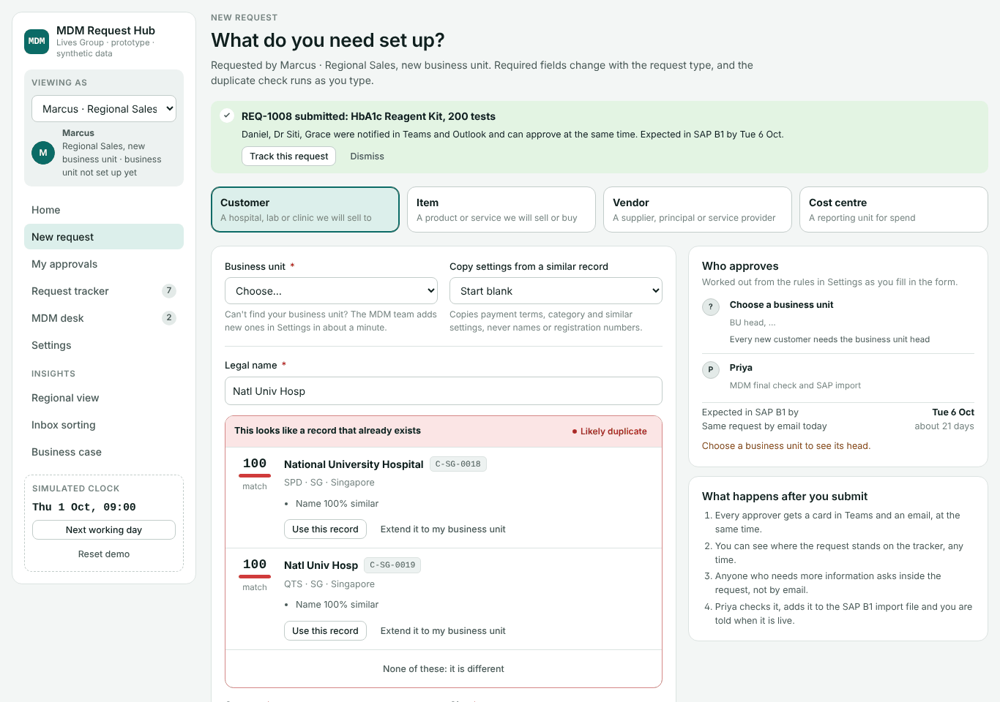
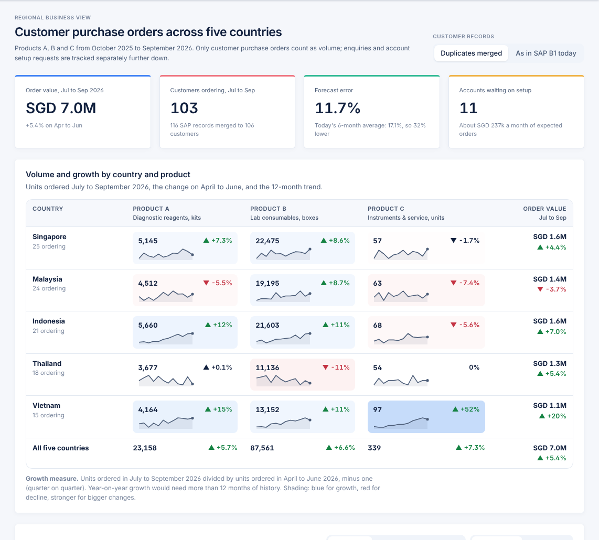

# MDM Request Hub · Lives Group

A working prototype for the **SMU DSA Society 2026 Data Case Competition**: one request form for new customers, items, vendors and cost centres, with parallel approvals in Teams and Outlook, a live status page and an import file for SAP Business One. The same clean records feed a regional sales view: purchase orders for Products A, B and C across Singapore, Malaysia, Indonesia, Thailand and Vietnam, with a forecast that is measurably better than today's spreadsheet average.

| | |
|---|---|
| **Live prototype** | https://luochuan91.github.io/lives-mdm-hub/ *(live once GitHub Pages is switched on, see below)* |
| **Demo video** | `https://youtu.be/<video-id>` *(2 to 3 minutes; add the link after uploading)* |
| **Two-page summary** | [docs/summary.pdf](docs/summary.pdf) |
| **Repository** | https://github.com/LuoChuan91/lives-mdm-hub |



All data is synthetic and generated with a fixed seed. Apart from National University Hospital, which the case brief itself uses as its example, every name, registration number, bank detail and volume is invented.

---

## The problem, briefly

Master data requests travel by email. A request is missing a field, so it bounces back; approvers review one after another; nobody can see where a request stands; and the MDM team keys every record into SAP B1 by hand, relying on memory to spot near-duplicates. On our synthetic history of 354 requests, a request took **18.0 days on average** (median 16.4; one in ten took more than 28.8 days), and 38% bounced back at least once for missing information.

The same duplicates then distort the sales view. A customer recorded twice looks like a new account, the "old" record looks like a customer that stopped ordering, and a Johor hospital filed under Singapore puts Malaysian orders in the Singapore numbers.

## What the prototype does

| Page | Who uses it | What it shows |
|---|---|---|
| **New request** | Requestors (Amy, Marcus, Nurul) | Fields change with the request type (a licence number appears only for regulated items); the duplicate check runs as you type, including initials such as "Natl Univ Hosp" and pack-size variants; the approvers are worked out from rules before you submit. |
| **My approvals** | Approvers (Wei Jie, Dr Siti, Daniel and others) | Teams-style cards with the facts each approver checks. Approve, ask for information or reject. Bank details stay masked until the approver chooses to see them, and that view is logged. |
| **Request tracker** | Everyone | Where every request stands, who it is waiting on, overdue reminders, full history. |
| **MDM desk** | The MDM team (Priya) | Final duplicate check, SAP code assignment, the Data Transfer Workbench import file, master data health (existing duplicates) and an append-only audit log. |
| **Settings** | The MDM team | Business units, form fields, approval rules and service levels are data, not code. Adding Marcus's new business unit takes a minute and needs no IT change. |
| **Regional view** | Sales and management | Volume and growth by country and product, the forecast and its backtest, where the growth came from, orders kept apart from enquiries and setup requests, signals for sales, recommended actions, and what merging duplicates changes. |
| **Inbox sorting** | Order desk, MDM team | A small text model sorts shared-mailbox emails into purchase orders, enquiries, setup requests and follow-ups, and pulls out the PO number, quantity and item. |
| **Business case** | Management | Turnaround model with sliders, hours saved, build cost, payback, alternatives, adoption plan and the Microsoft 365 production design. |

A simulated clock lets you move to the next working day to see reminders and escalations fire. Everything you do is saved in your browser; **Reset demo** starts again.



### Try it in three minutes

The home page has a guided demo. Each step switches to the right person:

1. **Amy** asks for a new reagent pack. Choosing *IVD reagent* adds the licence field and puts Quality/Regulatory on the route. The form flags the 100-test pack as a possible duplicate; she explains why hers is different.
2. **Marcus** types "Natl Univ Hosp". The form shows that National University Hospital already exists, before any approver sees the request.
3. **Wei Jie** approves from a Teams-style card. Bank details stay masked until he clicks *Show*, and the view is logged.
4. **Next working day.** Overdue approvals get a reminder, then an escalation.
5. **Priya** adds Marcus's new business unit in Settings; his requests now route to its head.
6. **Priya** passes the final check and produces the SAP B1 import file.
7. **Regional view**: growth by country and product, the forecast, and what changes once duplicate customers are merged.

## Results on the synthetic data

| Measure | Today | With the hub | How we got it |
|---|---|---|---|
| Request turnaround (average) | 18.0 days | **3.0 days** (9 in 10 within 4.7) | Monte Carlo model of 20,000 simulated requests, calibrated to 12 months of email-era history |
| Forecast error, 1 to 3 months ahead (WAPE) | 17.1% (6-month average, under-forecasts by 13%) | **11.7%** (bias −2.2%) | Rolling-origin backtest, March to June 2026 origins, value-weighted |
| Duplicate customers found | n/a | **10 of 10**, no false merges | Planted duplicates with ground truth in `data/planted_patterns.json` |
| Mailbox messages sorted correctly | manual | **96.7%** on 902 unseen emails | TF-IDF + logistic regression; 96% sorted without a person at ≥ 80% confidence (97.6% correct) |
| Staff time saved | | **≈ 765 hours a year** (≈ 0.5 full-time staff, ≈ SGD 42k) | Minutes per request before and after, all adjustable on the Business case page |
| Build cost and payback | | **≈ SGD 20.6k**, pays back in **≈ 6 months** | 156 internal hours plus 10 days of outside help; Microsoft 365 licences assumed in place |

What the regional view finds (July to September 2026 against April to June 2026):

- **Indonesia is the growth market.** Product A up 12% and Product B up 11%; six Indonesian hospitals opened accounts this year and five more are waiting on setup. *Action: fast-track Indonesian setups and plan extra A and B stock for Q4.*
- **Vietnam's instrument growth rests on three hospitals.** Product C up 52%, all of it from three accounts. *Action: win more instrument accounts before planning on this continuing.*
- **Thailand lab consumables are falling.** Product B down 11%; Pattaya Bay Hospital (about SGD 48k a month) has not ordered since 29 June. *Action: account manager call this week.*
- **17 hospitals buy reagents and consumables but no instruments**, while most similar hospitals buy all three (about SGD 57k a month of potential). *Action: hand the list to the instruments team for Q4 visits.*
- **Duplicates distort the customer view.** Before merging, 2 of 5 "going quiet" alerts were false, 3 of 4 "new accounts" were existing customers, and 2,887 boxes of Malaysian Product B orders were counted in Singapore.



## How it works

**One engine, two languages.** The analysis runs in Python (`analysis/`) and writes every number the app shows into `assets/data.js`. The parts that must run live in the browser (duplicate matching, the inbox classifier, the workflow and the turnaround model) are written again in JavaScript (`assets/engine.js`). Tests check that the two agree: the same duplicate scores within 0.15 points and the same classifier probabilities within 0.002.

**Duplicate matching** (`analysis/dedup.py`, shared rules in `analysis/textnorm.json`). Names are normalised (legal suffixes such as Sdn Bhd, PT and Co., Ltd. removed; abbreviations such as Hosp, Univ and Natl expanded; initials such as NUH recognised), then compared with an edit-distance ratio that weighs distinctive words above generic ones such as "hospital" or "clinic". Matching registration numbers, phone numbers, addresses, email domains and bank accounts raise the score; a different country, city or facility type lowers it. Scores of 90 and above are *likely* duplicates; 75 to 89 are *possible* and go to a person. Items also check pack sizes, variants (glove sizes, EDTA versus serum tubes) and manufacturer part numbers.

**Forecasting** (`analysis/forecasting.py`). Twelve months of history is too short for seasonality or machine learning, so the method is deliberately simple and explainable: a damped-trend model for each country and product, averaged with a regional model split by each country's recent share. Intermittent series use Croston's method. We hid each month from March to June 2026, forecast one to three months ahead from the months before it, and compared with what customers actually ordered. Repeating last month scores about the same (11.4%) but its forecast swings 15% from month to month against 7% for the combined method, so stock plans built on it would lurch.

**Growth measure.** Units ordered in July to September 2026 divided by units ordered in April to June 2026, minus one (quarter on quarter). Year-on-year growth would need more than 12 months of history. Only customer purchase orders count as volume; enquiries, setup requests and follow-ups are counted separately.

**Turnaround model** (`analysis/process_sim.py`). Today: triage, a 40% chance of bouncing back for missing fields, approvals one after another, possible clarification rounds and manual keying. With the hub: required fields enforced, approvals in parallel, a reminder at the service level and an escalation one working day later. The sliders on the Business case page re-run the same model in the browser.

**Inbox sorting** (`analysis/triage.py`). TF-IDF over words and word pairs with a logistic regression, trained on 2,703 messages and tested on 902 it never saw. Greetings and sign-offs are removed so the model learns intent, not politeness. Mistakes cluster on mixed messages (an order with a question attached); below 80% confidence the email goes to a person.

## How it would run at Lives Group

| In this prototype | In production | Built by |
|---|---|---|
| Request form | Power Apps (Microsoft Forms for the simplest types) | MDM team and one power user |
| Requests, settings, audit log | SharePoint lists (Dataverse later if needed) | MDM team |
| Routing, reminders, escalation | Power Automate with Teams and Outlook approvals | MDM team and one power user |
| Duplicate check | The same matching logic as a small Azure Function called by the flow | Outside help, short engagement |
| SAP B1 import file | Data Transfer Workbench import; Service Layer write-back in phase 3 | MDM team; SAP partner for phase 3 |
| Regional view and forecast | Power BI on SAP B1 purchase-order data | Analyst, with help for the data connection |
| Inbox sorting | AI step in Power Automate on the shared mailbox | Phase 3 pilot |

**Rollout.** Phase 1 (about 8 weeks): customer and item requests, parallel approvals, tracker, audit log and import file, piloted with SPD. Phase 2: all request types and business units, the duplicate-check service, the Power BI regional view, merging existing duplicates. Phase 3: SAP B1 write-back, inbox sorting, automated monthly forecast refresh.

**Getting people off email.** Approval cards arrive in Teams and Outlook, so approvers learn nothing new; the form is faster than an email because it copies settings from a similar record; the shared mailbox auto-replies with the form link; once a business unit is live, email requests are no longer processed (for SPD from 4 January 2027, the end of the pilot; the date is a setting); each business unit has a champion; and leadership sees a weekly view of form usage, turnaround and overdue approvals.

## Assumptions

Every figure on the Business case page can be changed in the app. The defaults:

- **Minutes per request**, today → with the hub: MDM team 50 → 13, requestor 30 → 5, each approver 10 → 4.
- **Staff cost:** SGD 55 an hour, fully loaded.
- **Duplicates:** 8% of new customer setups today are duplicates; the form catches 90%; each one costs 6 hours to untangle later.
- **Forecast preparation:** 16 hours a month today, 2 with the hub.
- **Inbox sorting:** 1.5 minutes saved per message sorted automatically.
- **Build:** 156 internal hours plus 10 days of outside help at SGD 1,200 a day.
- **Licences:** phase 1 uses standard connectors included in Microsoft 365. The phase 2 duplicate-check service needs a premium connector; that cost is not included and needs checking with Lives Group.
- **Turnaround with the hub:** approvers reply in 1.4 days on average; 5% of requests still bounce back and 8% need a question; reminders after 2 working days, escalation one working day later.
- **Data:** 12 months of synthetic history (October 2025 to September 2026); 116 customer records, of which 10 are planted duplicates.

## Run it yourself

The app uses HTML, CSS and JavaScript with a Python server for login and registration. No build step is needed.

```bash
# serve the folder, then open http://localhost:8000
python3 server.py
```

Open http://localhost:8000/login.html after starting the server. VS Code Live Server, `python3 -m http.server`, and opening HTML files directly cannot process account requests. The legacy standalone export does not support authenticated login.

Rebuild the data and every number in the app:

```bash
pip install -r requirements.txt
python analysis/generate_data.py   # synthetic data in data/ (fixed seed, identical every run)
python analysis/build_data.py      # analysis -> assets/data.js and analysis/output/RESULTS.md
```

Tests:

```bash
node --test tests/engine.test.cjs                        # workflow engine and Python/JavaScript parity (Node 20+)
python -m unittest discover -s tests -p "test_*.py"      # analysis
pip install playwright && playwright install chromium
python tests/e2e.py                                      # every page and the demo path in a real browser
```

The results in this repository were produced with Python 3.13, pandas 3.0, NumPy 2.5 and scikit-learn 1.9. Other versions may differ in the last decimal place.

### Publish on GitHub Pages

1. Create a public repository (for example `lives-mdm-hub`) and push this folder to its `main` branch.
2. In the repository, open **Settings → Pages**, choose **Deploy from a branch**, branch `main`, folder `/ (root)`, and save.
3. After a minute the prototype is live at https://luochuan91.github.io/lives-mdm-hub/. If you use a different account or repository name, change the links at the top of this README and in the summary.

## Repository layout

```
index.html                 the app shell
assets/
  app.js                   workflow pages: request form, approvals, tracker, MDM desk, settings
  insights.js              regional view, inbox sorting, business case
  engine.js                rules, routing, SLAs, duplicate matching, classifier, import file (also runs in Node)
  charts.js                small SVG chart helpers, no libraries
  data.js                  generated by analysis/build_data.py
  app.css
analysis/
  generate_data.py         synthetic SAP B1 master data, 12 months of orders, mailbox, request history
  dedup.py                 duplicate matching and clustering
  forecasting.py           forecast methods and the rolling-origin backtest
  process_sim.py           turnaround model
  triage.py                inbox classifier
  build_data.py            runs everything and writes assets/data.js
  output/RESULTS.md        digest of every result
data/                      the synthetic data as CSV, plus planted_patterns.json (ground truth)
scripts/build_single_file.py
tests/                     engine and parity tests (Node), analysis tests (Python), browser test (Playwright)
docs/                      demo script and screenshots
```

## Notes

- **Data.** Everything is synthetic, generated by `analysis/generate_data.py`. Patterns were planted on purpose (duplicates, look-alikes that are *not* duplicates, a customer filed under the wrong country, growth in Indonesia, a falling Thai account, concentrated growth in Vietnam) and `data/planted_patterns.json` records each one, so the methods can be checked against the truth.
- **Security.** The prototype masks bank details and credit limits by role and logs every view and change. It is not a security model; production would rely on Microsoft 365 permissions and an IT security review.

## Local login and role workspace

Start the authenticated app with `python3 server.py` and open
[http://localhost:8000](http://localhost:8000). No extra Python packages are needed for the server.
Create an account in the registration tab and choose a role; login checks the username,
password and role against `test_users.json` in the project root. This test account file
is included in the repository and cannot be downloaded through the Python web server.
Sign in with username `testuser`, password `TestUser123!`, and role **Requester**.
Registration also saves accounts to this file; use test credentials only in this shared fixture. Passwords are salted
PBKDF2 hashes, rather than readable passwords. Sessions expire after eight hours.

Requesters create requests. Approvers review their assigned workflow steps. MDM accounts
use the MDM desk and settings. All roles can track requests and view insights. Role selection
is open at registration for this local prototype. Accounts map to existing demo workflow
identities (requester → Amy, Finance → Wei Jie, Quality → Siti, SPD head → Daniel,
Business Support → Grace, Procurement → Hafiz, MDM → Priya), so accounts in the same role
share workflow assignments. Workflow records still live in browser local storage; they are
not synchronized between browsers. Account checks run in Python; workflow role restrictions
run in the browser. This is a local prototype, not a multi-user production authorization system.

Visual styling is centralized in `assets/app.css`. The dashboard uses a navy header,
white sidebar, blue active navigation, compact tables and white summary cards. The simulated
clock controls and persona-switching demo are removed; request timing uses the current UTC time.
The login requires the Python server; static hosting and standalone HTML exports do not
provide the account API.
