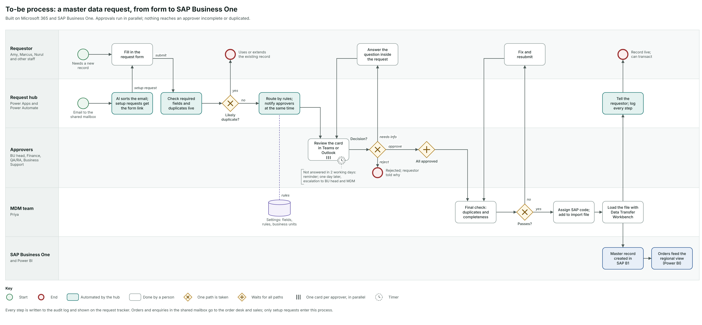
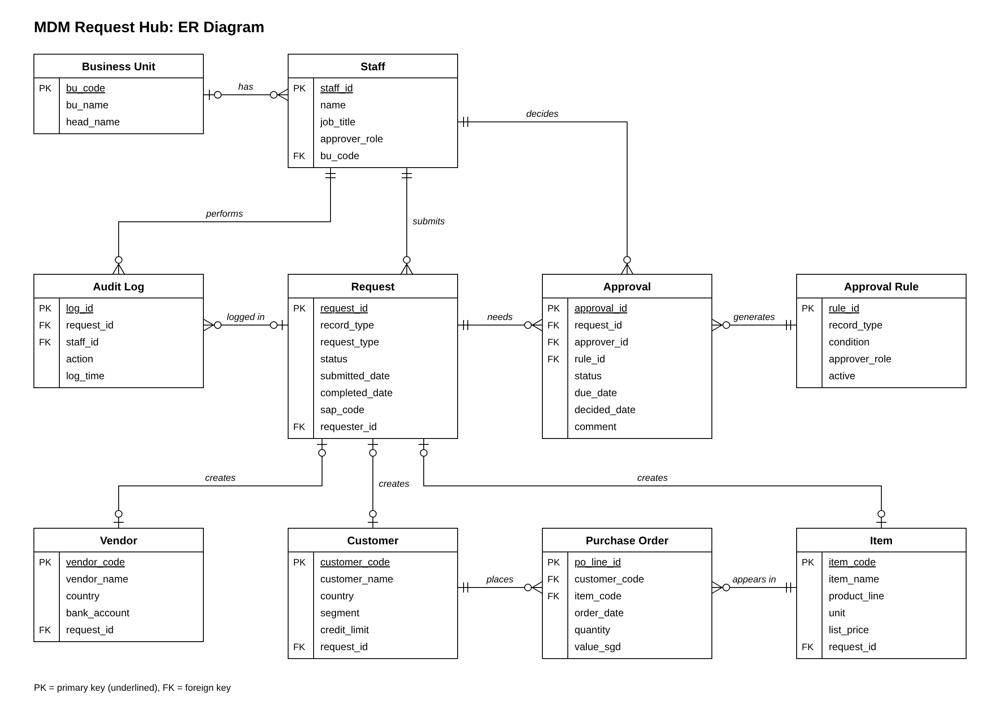

# MDM Request Hub · Lives Group

A working prototype for Lives Group. One request form for new customers, items, vendors and cost centres, with parallel approvals in Teams and Outlook, a live status page and an import file for SAP Business One. The same clean records feed a regional sales view: purchase orders for Products A, B and C across Singapore, Malaysia, Indonesia, Thailand and Vietnam, with a forecast that is measurably better than today's spreadsheet average.

| | |
|---|---|
| **Demo video** | `https://youtu.be/FZe3zLYYH1M` |
| **Sign in** | Any demo account, password `Lives2026!` (see [Sign-in and roles](#sign-in-and-roles)) |
| **Repository** | https://github.com/LuoChuan91/lives-mdm-hub |

All data is synthetic and generated with a fixed seed. Apart from National University Hospital, which the case brief itself uses as its example, every name, registration number, bank detail and volume is invented.

---

## What the prototype does

| Page | Who uses it | What it does |
|---|---|---|
| **New request** | Requesters (Amy, Marcus, Nurul) | Request form with a live duplicate check; it works out the approvers from the rules before you submit |
| **My approvals** | Approvers (Wei Jie, Dr Siti, Daniel and others) | Teams-style approval cards: approve, ask for information or reject |
| **Request tracker** | Everyone | Status of every request, who it is waiting on and its full history |
| **MDM desk** | MDM team (Priya) | Final duplicate check, SAP codes, the SAP B1 import file, existing duplicates and the audit log |
| **Settings** | MDM team | Business units, form fields, approval rules and service levels |
| **Regional view** | Sales and management | Orders and growth by country and product, the forecast, sales signals and the effect of duplicate records |
| **Market scenarios** | Sales, finance and management | How exchange rates, tariffs and slower hospital spending would change next quarter's orders |
| **Inbox sorting** | Order desk, MDM team | Sorts shared-mailbox emails into orders, enquiries, setup requests and follow-ups |
| **Business case** | Management | Turnaround model, time saved, cost and payback, with every assumption adjustable |

### Demo video

The video follows one request through each person's account (sign-in details are under [Sign-in and roles](#sign-in-and-roles)):

1. **Amy** asks for a new reagent kit. The form flags the existing 100-test pack as a possible duplicate; she explains why hers is different and sees who will approve it and when it will be live.
2. **Marcus** types "Natl Univ Hosp". The form shows that National University Hospital already exists, before any approver sees the request.
3. **Wei Jie** sees what is waiting for him. Bank details stay masked until he clicks *Show*, and that view is logged; he approves a new customer from a Teams-style card.
4. **Next working day.** Overdue approvals get a reminder, then an escalation.
5. **Priya** adds Marcus's new business unit in Settings; his requests now route to its head.
6. **Priya** passes the customer Wei Jie approved through the final check, and it goes into the SAP B1 import file.
7. **Regional view**: the records as they are in SAP B1 today against duplicates merged, then growth by country and product and the forecast error.
8. **Market scenarios**: *All three at once* shows which countries, product lines and customers a weaker currency, an instrument tariff and slower hospital spending would hit.
9. **Business case**: build cost, payback and how people move off email.

## Sign-in and roles

Every demo account uses the password **`Lives2026!`**. The login page lists them too: click a person to fill in the form.

| Person | Username | Role on the login page | Can do |
|---|---|---|---|
| Amy | `amy` | Requester · SPD | Create requests (item, customer, vendor, cost centre) |
| Marcus | `marcus` | Requester · new business unit | Create requests; his business unit is not set up yet |
| Wei Jie | `weijie` | Finance approver | Approve credit terms, vendor bank details and cost centres |
| Dr Siti | `siti` | Quality & Regulatory approver | Approve regulated items and principals' quality agreements |
| Daniel | `daniel` | Business Unit Head · SPD | Approve SPD customers, items and cost centres |
| Grace | `grace` | Business Support approver | Approve item pricing and public-hospital tender checks |
| Hafiz | `hafiz` | Procurement approver | Evaluate new vendors |
| Priya | `priya` | MDM administrator | MDM desk, SAP import file, Settings |

There is also `testuser` / `TestUser123!` (Requester · SPD). Accounts you create on the *Create account* tab share the approvals of the person their role belongs to.

Each account only sees its own tools: requesters get the request form, approvers their approvals, and the MDM team the MDM desk and Settings. Requests and the simulated clock are saved in the browser and shared by all accounts in it, so a request Amy submits is waiting when Wei Jie signs in. **Reset demo** in the left menu starts again. The demo passwords are public on purpose.

## Diagrams

The to-be process flow and the ER diagram are in [`docs/diagrams/`](docs/diagrams).





## How the prototype works

The analysis is in Python (`analysis/`) and writes the figures the app shows into `assets/data.js`. Duplicate matching, the inbox classifier, the workflow and the turnaround model are also written in JavaScript (`assets/engine.js`) so they run in the browser, and the tests check that both versions give the same results.

- **Duplicate matching** (`analysis/dedup.py`): names are cleaned up (legal suffixes such as Sdn Bhd and PT removed, abbreviations such as Hosp and Natl expanded) and compared by edit distance. Matching registration numbers, phone numbers, addresses and bank accounts raise the score, and a different country or city lowers it. A score of 90 or more is a likely duplicate; 75 to 89 goes to a person to check.
- **Forecast** (`analysis/forecasting.py`): with only 12 months of history we kept it simple, a damped-trend model for each country and product averaged with a regional model. We tested it by forecasting one to three months ahead from March to June 2026 and comparing with actual orders.
- **Growth**: units ordered in July to September 2026 compared with April to June 2026, counting customer purchase orders only.
- **Turnaround** (`analysis/process_sim.py`): a simulation of 20,000 requests comparing today's process (requests sent back, approvals one after another) with the hub (required fields, parallel approvals, reminders). The sliders on the Business case page rerun it.
- **Market scenarios** (`assets/engine.js`): the October to December forecast split by customer, with exchange-rate and tariff changes passed into prices and orders through price sensitivities for each product and customer type. Twelve months of data is too little to estimate these, so they are assumptions you can change on the page.
- **Purchase likelihood** (`analysis/propensity.py`): we tested a logistic regression that predicts which customers order each product next quarter. It scored an AUC of 0.976, but the simple rule "ordered in the last 3 months" scored 0.973, so the market scenarios use the forecast and recent orders instead.
- **Inbox sorting** (`analysis/triage.py`): TF-IDF with logistic regression, trained on 2,703 emails and tested on 902 others. Emails below 80% confidence go to a person.

The assumptions behind the business case and the market scenarios are listed on those two pages in the app, where you can change them.

## How to run the prototype

The app is plain HTML, CSS and JavaScript with no build step. `server.py` is optional and uses only the Python standard library.

```bash
# with the account server (logins checked in Python), then open http://localhost:8000
python3 server.py

# or any static server, as on GitHub Pages (logins checked in the browser), then open http://localhost:8000
python3 -m http.server 8000
```

Opening `index.html` directly from disk also works. `python3 scripts/build_single_file.py --document` writes a single self-contained HTML file to `dist/` for offline demos, login card included.

Rebuild the data and every number in the app:

```bash
python3 -m pip install -r requirements.txt
python3 analysis/generate_data.py   # synthetic data in data/ (fixed seed, identical every run)
python3 analysis/build_data.py      # analysis -> assets/data.js and analysis/output/RESULTS.md
```

Tests:

```bash
node --test tests/engine.test.cjs                        # workflow engine and Python/JavaScript parity (Node 20+)
python3 -m unittest discover -s tests -p "test_*.py"     # analysis, the account server and the demo accounts
python3 -m pip install playwright && python3 -m playwright install chromium
python3 tests/e2e.py                                     # every page and the demo path in a real browser
```

The results in this repository were produced with Python, pandas, NumPy and scikit-learn.

## Repository layout

```
index.html                 the app shell
login.html                 sign-in page, with the demo accounts
server.py                  local account server: login, registration, sessions (standard library only)
test_users.json            test accounts, passwords stored as salted PBKDF2 hashes
assets/
  app.js                   workflow pages: request form, approvals, tracker, MDM desk, settings
  insights.js              regional view, inbox sorting, business case
  market.js                market scenarios page
  auth.js                  checks who is signed in (server cookie or browser session), then loads the app
  login.js                 sign-in and registration; checks passwords in the browser when there is no server
  session.js               the browser sign-in session
  demo-accounts.js         the demo account per person shown on the login page
  accounts.js              browser copy of test_users.json (hashes only), written by server.py
  engine.js                rules, routing, SLAs, duplicate matching, classifier, import file (also runs in Node)
  charts.js                small SVG chart helpers, no libraries
  data.js                  generated by analysis/build_data.py
  app.css
analysis/
  generate_data.py         synthetic SAP B1 master data, 12 months of orders, mailbox, request history
  dedup.py                 duplicate matching and clustering
  forecasting.py           forecast methods and the rolling-origin backtest
  process_sim.py           turnaround model
  triage.py                inbox classifier
  propensity.py            purchase-likelihood model and its out-of-time test
  build_data.py            runs everything and writes assets/data.js
  output/RESULTS.md        digest of every result
data/                      the synthetic data as CSV, plus planted_patterns.json (ground truth)
scripts/
  build_single_file.py     one self-contained HTML file for offline use
tests/                     engine and parity tests (Node), analysis and account tests (Python), browser test (Playwright)
docs/diagrams/             to-be process flow and ER diagram
```

## Notes

- **Data.** Everything is synthetic, generated by `analysis/generate_data.py`. Patterns were planted on purpose and `data/planted_patterns.json` records each one, so the methods can be checked against the truth.
- **Security.** The prototype masks bank details and credit limits by role and logs every view and change. In production, sign-in and permissions would come from Microsoft 365, with an IT security review.
